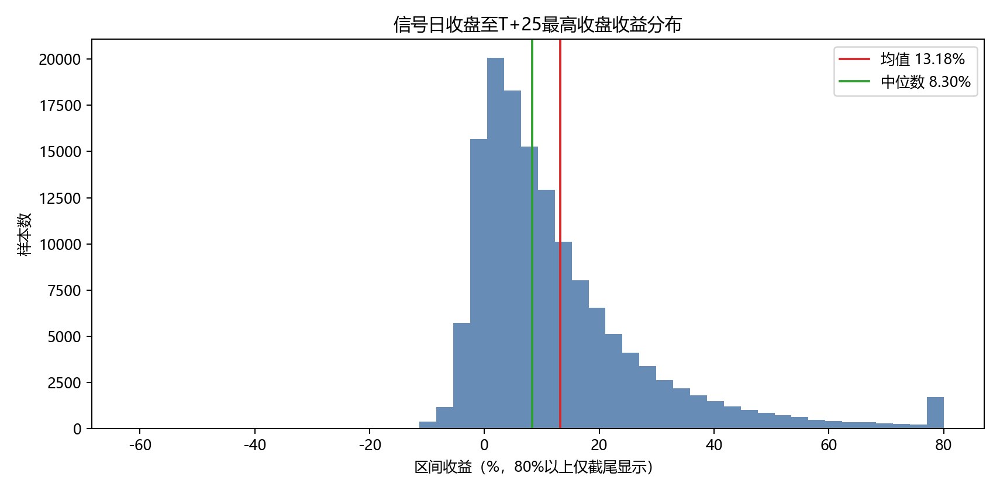
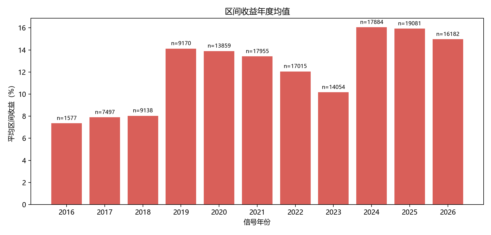
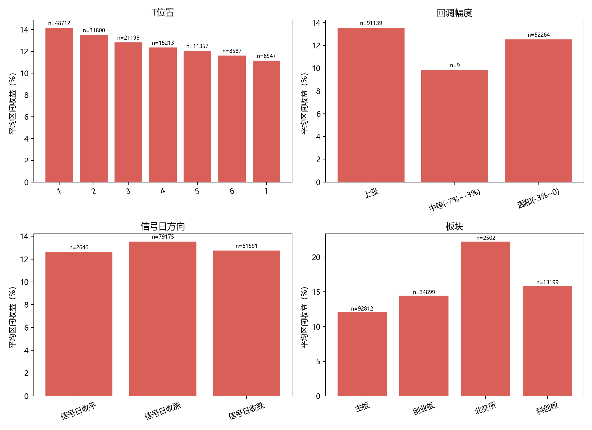
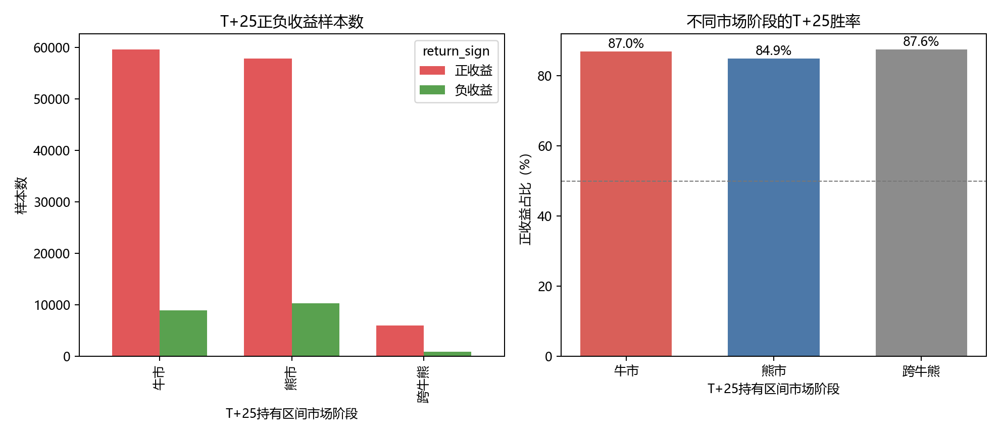
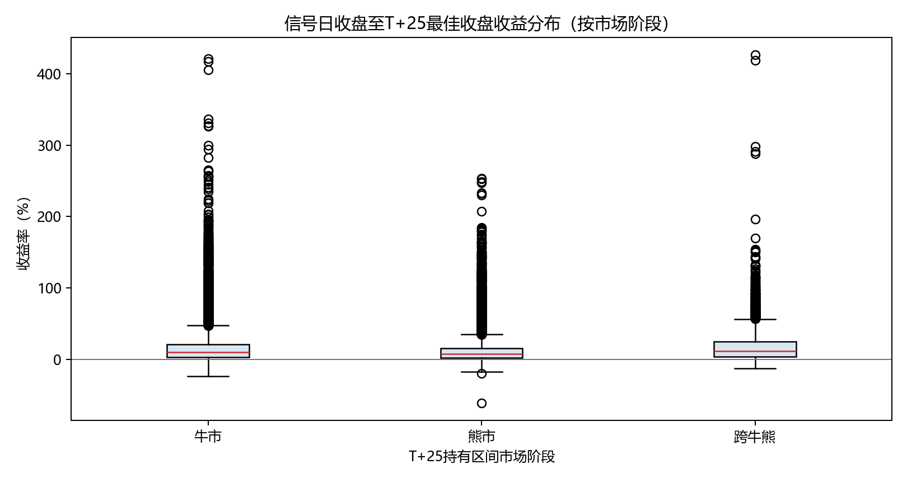

# ZT回调公式：最终回测报告

## 公式规则

严格按用户给定公式执行：ZT为收盘相对前一交易日上涨超过9%；T为最近一次ZT至当前K线的有效交易日间隔；信号要求T在1至7之间，并同时满足回调区间高点不超过涨幅日收盘的108%、低点不低于涨幅前后收盘中点、区间平均收盘不低于98%、区间收盘低点不低于96%、当前收盘不低于97%，且不存在跌幅达到5%的阴线。原式定义IS_MAIN但未写入XG，因此全样本为正式口径，主板仅作子集统计。

## 收益口径

买入点为信号日收盘；卖出点为买入后T+1至T+25内最高后复权收盘价。T+25观察边界按个股有效K线计数，路径终点为事后最优，不代表可预知成交收益。

## 核心结果

| 事件数 | 有效路径样本 | 区间均值 | 中位数 | P10 | P90 | 正收益占比 | 路径平均超额 |
|---:|---:|---:|---:|---:|---:|---:|---:|
| 145,704 | 143,412 | +13.18% | +8.30% | -0.93% | +32.34% | 86.0% | +10.40% |

## 分组统计

### T位置
| 分组 | 样本数 | 区间均值 | 中位数 | P10 | P90 | 路径平均超额 |
|---|---:|---:|---:|---:|---:|---:|
| 1 | 48,712 | +14.17% | +8.92% | -1.36% | +35.24% | +11.21% |
| 2 | 31,800 | +13.52% | +8.69% | -0.87% | +32.73% | +10.68% |
| 3 | 21,196 | +12.82% | +7.99% | -0.80% | +31.20% | +10.15% |
| 4 | 15,213 | +12.35% | +7.96% | -0.77% | +29.82% | +9.70% |
| 5 | 11,357 | +12.07% | +7.73% | -0.52% | +28.98% | +9.51% |
| 6 | 8,587 | +11.62% | +7.42% | -0.52% | +28.11% | +9.15% |
| 7 | 6,547 | +11.14% | +7.07% | -0.48% | +27.22% | +8.68% |

### 回调幅度
| 分组 | 样本数 | 区间均值 | 中位数 | P10 | P90 | 路径平均超额 |
|---|---:|---:|---:|---:|---:|---:|
| 上涨 | 91,139 | +13.55% | +8.59% | -1.02% | +33.22% | +10.61% |
| 中等(-7%~-3%) | 9 | +9.85% | +8.76% | -0.58% | +22.93% | +8.42% |
| 温和(-3%~0) | 52,264 | +12.52% | +7.86% | -0.75% | +30.73% | +10.03% |

### 信号日方向
| 分组 | 样本数 | 区间均值 | 中位数 | P10 | P90 | 路径平均超额 |
|---|---:|---:|---:|---:|---:|---:|
| 信号日收平 | 2,646 | +12.61% | +8.06% | -0.58% | +29.76% | +9.66% |
| 信号日收涨 | 79,175 | +13.53% | +8.50% | -1.12% | +33.34% | +10.56% |
| 信号日收跌 | 61,591 | +12.74% | +8.08% | -0.70% | +31.15% | +10.23% |

### 板块
| 分组 | 样本数 | 区间均值 | 中位数 | P10 | P90 | 路径平均超额 |
|---|---:|---:|---:|---:|---:|---:|
| 主板 | 92,812 | +12.08% | +7.63% | -0.94% | +29.66% | +9.45% |
| 创业板 | 34,899 | +14.44% | +9.25% | -0.88% | +35.39% | +11.47% |
| 北交所 | 2,502 | +22.26% | +12.87% | -1.29% | +53.66% | +18.71% |
| 科创板 | 13,199 | +15.84% | +10.54% | -0.81% | +38.56% | +12.71% |

## 主板子集

| 分组 | 样本数 | 区间均值 | 中位数 | P10 | P90 | 路径平均超额 |
|---|---:|---:|---:|---:|---:|---:|
| 主板 | 92,812 | +12.08% | +7.63% | -0.94% | +29.66% | +9.45% |

## 市场阶段

[市场阶段分析](market_regime.md)

## 样本图

[代表性样本图](../figures/representative-samples.html)

[回调分组样本图](../figures/pullback-samples.html)

[牛熊反例样本图](../figures/market-regime-samples.html)

## 结论与限制

信号日收盘至T+25最佳收盘的路径收益均值为+13.18%、中位数为+8.30%；这描述的是公式事件后的历史价格空间，不等同于实盘可实现正期望。

结果未计佣金、滑点、涨跌停排队、仓位和资金占用；最佳买入/卖出位置均为事后识别。

## 文件

事件明细：results/events.csv；统计结果：results/summary.csv；策略入口：strategy/pattern.py；市场阶段分析：strategy/market_regime_analysis.py；报告生成：strategy/build_report.py
