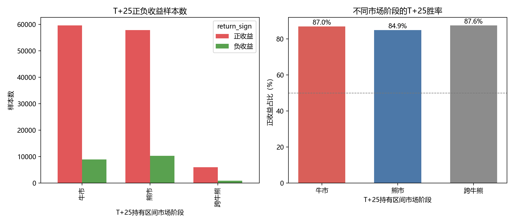
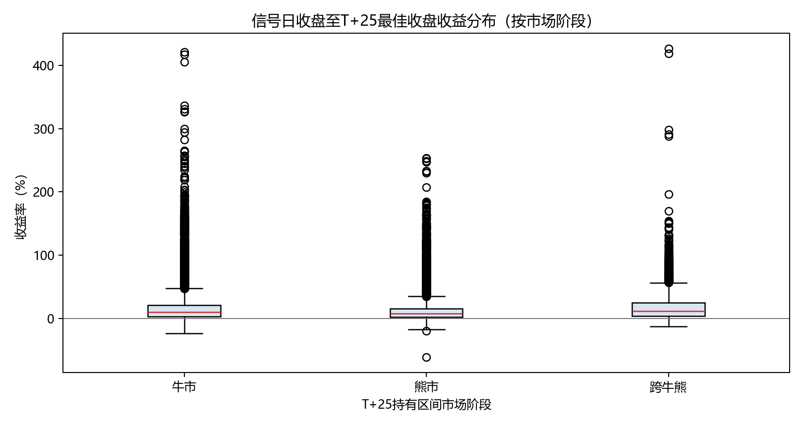

# ZT回调公式：市场阶段分析

以信号日收盘为起点，向后取第25根有效K线作为观察边界；T+1至T+25最高后复权收盘路径收益仅用于描述窗口空间，不代表可实现收益。

| T+25持有区间 | 样本数 | 正收益数 | 负收益数 | 正收益占比 | 平均收益 | 中位数 |
|---|---:|---:|---:|---:|---:|---:|
| 牛市 | 68,570 | 59,641 | 8,929 | 87.0% | +15.09% | +9.49% |
| 熊市 | 68,089 | 57,830 | 10,259 | 84.9% | +10.84% | +7.11% |
| 跨牛熊 | 6,753 | 5,914 | 839 | 87.6% | +17.23% | +11.00% |

